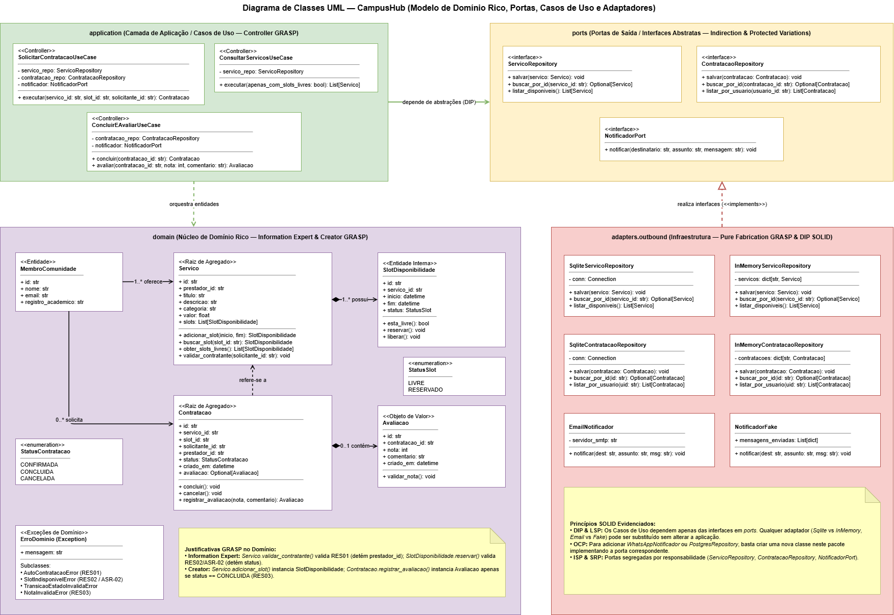
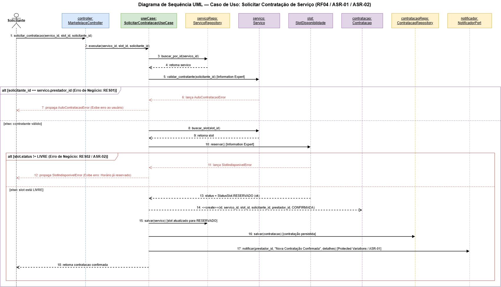
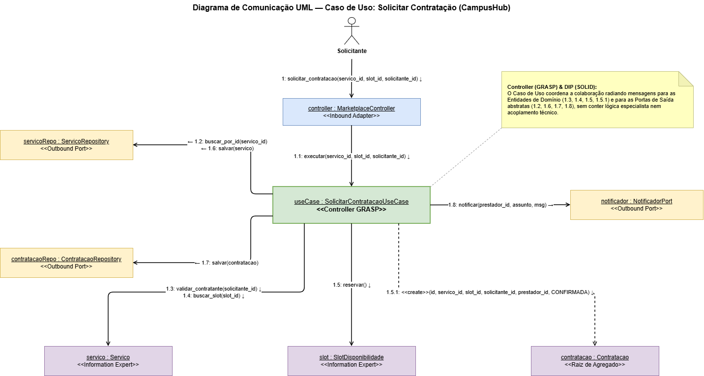
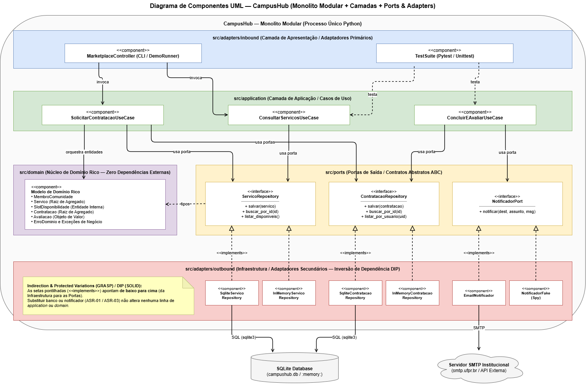

# 3. Modelagem UML e Consistência entre Modelos — CampusHub (Tema 11)

Este documento detalha as decisões de design e arquitetura representadas nos quatro modelos UML obrigatórios do **CampusHub**, localizados no diretório [`docs/diagramas/`](./diagramas/). O objetivo central da modelagem foi assegurar total consistência entre a visão estrutural estática, a visão comportamental dinâmica, a organização de componentes e o código-fonte implementado, alinhando cada elemento aos Requisitos Arquiteturalmente Significativos (ASRs), padrões **GRASP** e princípios **SOLID**.

---

## 3.1 Diagrama de Classes — [`diagramas/classes.puml`](./diagramas/classes.puml) | [`diagramas/classes.png`](./diagramas/classes.png)

O Diagrama de Classes modela o **Modelo de Domínio Rico** (*Rich Domain Model*) e sua relação com as Portas de Saída (`ports`), Casos de Uso (`application`) e Adaptadores Secundários (`adapters.outbound`), rejeitando o antipadrão de Modelo Anêmico.

* **Consistência Transacional (ASR-02) e *Information Expert* (GRASP):**
  * A entidade `Servico` atua como Especialista na Informação para validar a restrição **RES01** (proibição de auto-contratação) por meio do método `validar_contratante(solicitante_id: str)`, pois detém o atributo `prestador_id`.
  * A entidade interna `SlotDisponibilidade` detém o atributo `status: StatusSlot` (`LIVRE` ou `RESERVADO`) e encapsula a proteção de invariante no método `reservar()`, lançando `SlotIndisponivelError` caso o horário já esteja ocupado (**RES02 / ASR-02**).
* **Padrão *Creator* (GRASP):**
  * A instanciação de `SlotDisponibilidade` é responsabilidade de `Servico.adicionar_slot(inicio, fim)`.
  * A instanciação de `Avaliacao` é delegada ao método `Contratacao.registrar_avaliacao(nota, comentario)`. Isso blinda a integridade do domínio (**RES03**), garantindo que nenhuma avaliação seja criada órfã ou vinculada a uma contratação cujo estado não seja `CONCLUIDA`.
* **Alta Coesão e Inversão de Dependência (SRP e DIP - SOLID):**
  * As classes do pacote `domain` não possuem referências a SQL, rede ou frameworks externos.
  * Os Casos de Uso (`SolicitarContratacaoUseCase`, `ConsultarServicosUseCase`, `ConcluirEAvaliarUseCase`) dependem exclusivamente das interfaces abstratas em `ports` (`ServicoRepository`, `ContratacaoRepository`, `NotificadorPort`), que são realizadas (`..|>`) pelos adaptadores concretos em `adapters.outbound`.

---

## 3.2 Diagrama de Sequência — [`diagramas/sequencia.puml`](./diagramas/sequencia.puml) | [`diagramas/sequencia.png`](./diagramas/sequencia.png)

O Diagrama de Sequência retrata o fluxo dinâmico temporal da fatia vertical principal (**RF04 — Solicitar Contratação de Serviço**), incluindo os fluxos alternativos de exceção de negócio (`alt/else`).

* **Padrão *Controller* (GRASP) e Responsabilidade Única (SRP - SOLID):**
  * O `MarketplaceController` recebe a requisição de entrada e repassa ao controlador de caso de uso `SolicitarContratacaoUseCase.executar(servico_id, slot_id, solicitante_id)`.
  * O Caso de Uso não contém condicionais de negócio (`if`), delegando as validações diretamente para `servico.validar_contratante(solicitante_id)` e `slot.reservar()`.
* **Atomicidade e Tratamento Explícito de Erros (ASR-02):**
  * Caso `solicitante_id == servico.prestador_id`, `Servico` lança `AutoContratacaoError` e interrompe o fluxo antes de qualquer mutação.
  * Caso `slot.status != LIVRE`, `SlotDisponibilidade` lança `SlotIndisponivelError`, prevenindo *overbooking* e gravações parciais no banco de dados.
* **Isolamento de Efeitos Colaterais (ASR-01):**
  * O disparo de notificação externa via `notificador.notificar(...)` ocorre somente após a confirmação da persistência de `servico` e `contratacao` nos repositórios (`salvar()`), garantindo que o prestador nunca seja notificado sobre uma contratação não persistida.

---

## 3.3 Diagrama de Comunicação — [`diagramas/comunicacao.puml`](./diagramas/comunicacao.puml) | [`diagramas/comunicacao.png`](./diagramas/comunicacao.png)

Complementar ao Diagrama de Sequência, o Diagrama de Comunicação enfatiza a topologia estrutural e os vínculos de colaboração entre as instâncias que participam do Caso de Uso de contratação.

* **Visão Espacial da Coordenação (Controller GRASP):**
  * Evidencia que a instância `useCase : SolicitarContratacaoUseCase` atua como nó coordenador central, recebendo o estímulo `1.1: executar(...)` do `controller : MarketplaceController` e distribuindo mensagens numeradas hierarquicamente:
    * **Para as Portas de Saída (`ports`):** `1.2: buscar_por_id(servico_id)`, `1.6: salvar(servico)`, `1.7: salvar(contratacao)` e `1.8: notificar(prestador_id, assunto, msg)`.
    * **Para as Entidades de Domínio (`domain`):** `1.3: validar_contratante(solicitante_id)`, `1.4: buscar_slot(slot_id)`, `1.5: reservar()` e `1.5.1: <<create>>` em `Contratacao`.

---

## 3.4 Diagrama de Componentes — [`diagramas/componentes.puml`](./diagramas/componentes.puml) | [`diagramas/componentes.png`](./diagramas/componentes.png)

O Diagrama de Componentes apresenta a visão macroscópica do **Monolito Modular em Camadas com Ports & Adapters (Arquitetura Hexagonal Simplificada)**.

* **Direção Estrita das Dependências (DIP - SOLID):**
  * Todos os componentes convergem suas setas de dependência para o interior da arquitetura (`domain` e `ports`). O núcleo não conhece detalhes de `SQLite` nem de `SMTP`.
* **Substituibilidade de Integrações (ASR-01) e *Protected Variations* (GRASP):**
  * Os componentes `EmailNotificador` e `NotificadorFake` implementam a mesma porta `NotificadorPort`. A troca entre um adaptador real (ou futuro adaptador de WhatsApp) e o adaptador simulado exige apenas alterar a injeção de dependência no *Composition Root* (`main.py`).
* **Testabilidade Isolada (ASR-03):**
  * Demonstra como a `TestSuite (Pytest)` (adaptador primário) exercita diretamente os Casos de Uso injetando `InMemoryServicoRepository`, `InMemoryContratacaoRepository` e `NotificadorFake`, validando todas as regras de negócio em memória sem depender de banco de dados externo.

---

## 3.5 Verificação de Consistência entre Modelos e Código

Em atendimento direto aos critérios da **Seção 3 do Edital**, os quatro diagramas e o código-fonte mantêm rastreabilidade e consistência estrita:

1. **Consistência entre Diagrama de Sequência, Comunicação e Classes:** Todas as operações invocadas nos diagramas dinâmicos (`executar`, `buscar_por_id`, `validar_contratante`, `buscar_slot`, `reservar`, `salvar`, `notificar`) possuem a exata mesma assinatura, ordem de parâmetros e classe detentora definidas no Diagrama de Classes (`classes.puml`) e implementadas em `src/`.
2. **Consistência entre Diagrama de Componentes e Organização Arquitetural:** Os pacotes modelados no Diagrama de Componentes (`domain`, `ports`, `application`, `adapters.inbound`, `adapters.outbound`) refletem fielmente a estrutura modular documentada em [`docs/arquitetura.md`](./arquitetura.md).
3. **Coerência das Dependências com o Código:** Nenhuma entidade em `src/domain/` importa módulos de `application` ou `adapters`, e os casos de uso dependem exclusivamente de contratos abstratos (`abc.ABC`) em `src/ports/`.
